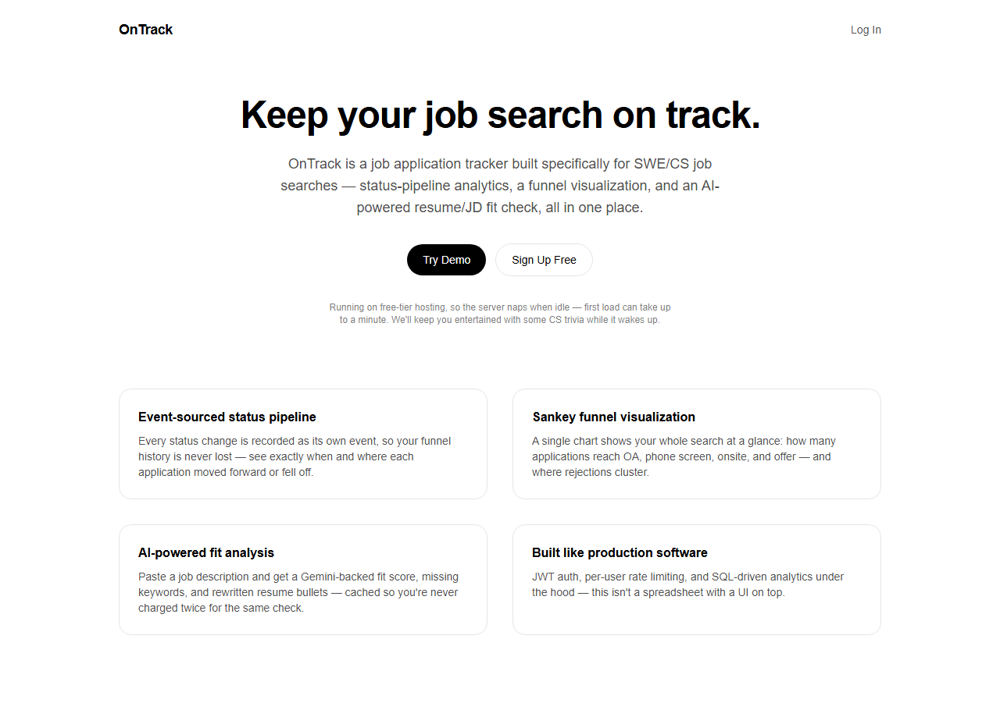
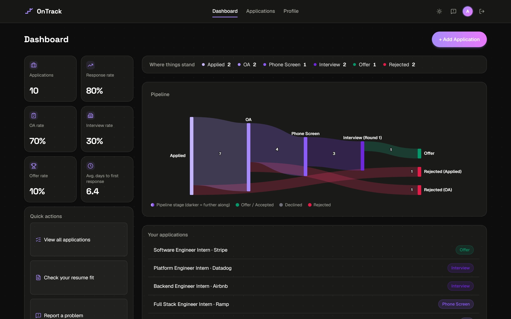
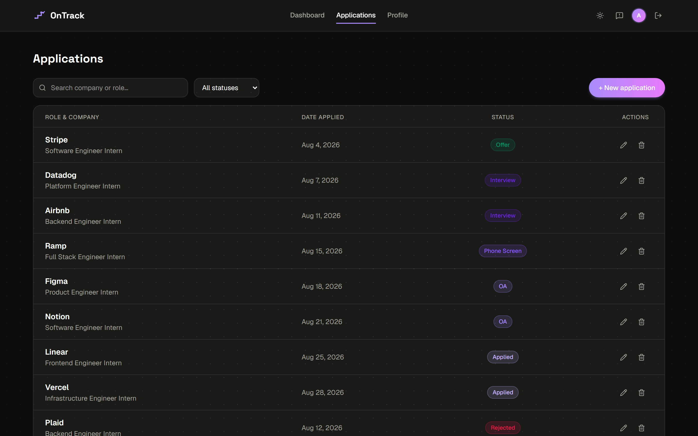
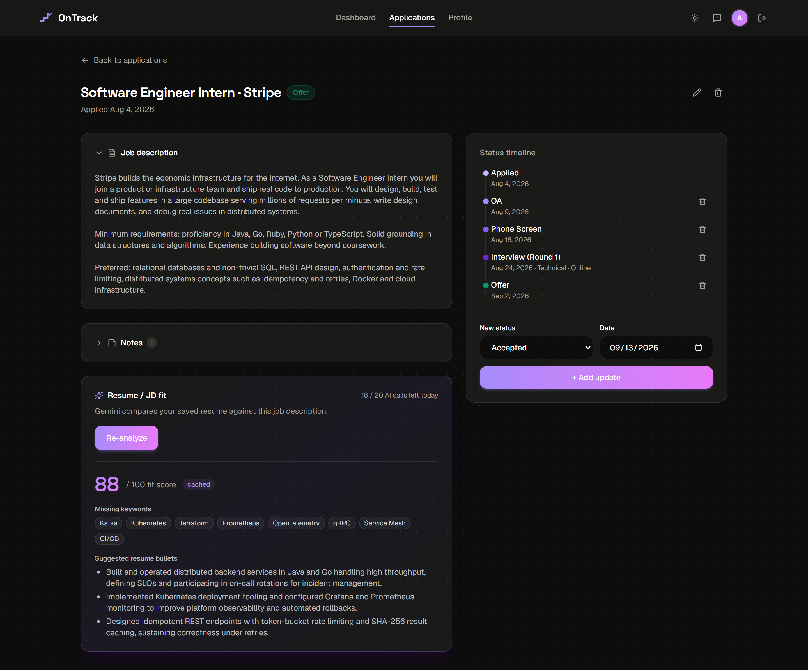
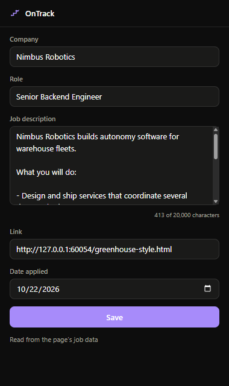

# OnTrack

A full-stack job application tracker website built for general CS job searches. Features include a dashboard containing an application status pipeline and application statistics, application manager, and a Gemini-powered resume and job-description fit check.

**Live demo:** [ontrack.abhinavgonthina.dev](https://ontrack.abhinavgonthina.dev). Click "Try Demo" for a read-only tour with seeded data, or sign up for your own account!

> The backend runs on a single small free-tier instance, kept warm by an uptime monitor, so it normally responds right away. A fresh deploy or a restart still means a cold boot, which takes a couple of minutes on that hardware. The UI says so plainly when it happens and keeps you occupied with a 100-question CS and SWE interview quiz while it starts.

## Screenshots

**Landing page**



**Dashboard: stage counts, funnel metrics, and a Sankey diagram of the whole pipeline**



**Applications: searchable, filterable and paginated**



**Application detail: status timeline, notes, and the Gemini fit analysis**



> Earlier versions of the interface are archived in [`docs/screenshots/legacy-ui/`](docs/screenshots/legacy-ui/).

## What it does

- **Track applications** through a full status pipeline (Applied, OA, Phone Screen, Interview, Offer, then Accepted or Declined, with a rejection possible at any stage), keeping a timeline of every change and free-form notes per application.
- **See the whole funnel at a glance.** The dashboard shows how many applications currently sit at each stage, response and OA and interview and offer rates, and a Sankey diagram of exactly where applications progressed or fell off. It is computed server-side with a SQL window function over the append-only status history, not from each application's latest status.
- **Check your resume against a job description.** Paste a JD and get a Gemini-backed fit score, the keywords you are missing, and rewritten resume bullets. Results are cached on a hash of the resume and JD pair, so re-opening a result never costs another API call.
- **Upload a resume as PDF or DOCX**, have it normalized into clean text, and score its strength across four fixed categories. Strength scores are cached against the resume text, so re-scoring unchanged text is free.
- **Try it with zero setup** through a public, read-only demo with 12 seeded applications and no signup.

## Browser extension



A Chrome and Firefox extension that logs the job posting you are looking at
straight into your account. Open a posting, click the OnTrack icon, and the
popup comes up with the company, role, job description, link and today's date
already filled in. Edit anything, press Save, and the application is created at
status Applied.

It is a logging tool and nothing else. It never fills in or submits forms on
job sites, never runs on a page unless you click the icon, and never sends page
content anywhere except your own OnTrack backend.

**Supported sites.** Greenhouse, Lever and Ashby are read through their public
board APIs; Workday through the tenant's own JSON endpoint from inside the
page; LinkedIn through the rendered page. Any site that publishes a schema.org
`JobPosting` works without a dedicated reader, which covers most of the long
tail. Readers run best first and merge field by field, so a board API that
knows the role but not the company still gets the company from the page. When
nothing can read a page, the popup offers to fill it in by hand or, only if you
agree and only after showing the cost, to spend one of your daily AI calls
having Gemini read it.

**Sign-in uses your existing OnTrack session and stores nothing.** No token, no
API key, no cookie value is written to extension storage. The service worker
sends `credentials: "include"` and the browser attaches the same session cookie
the web app already set. The only thing kept is an unsaved draft, in memory
backed session storage, so signing in or waiting out a cold start does not lose
what you were about to save.

**Installing it unpacked:**

```bash
cd extension
npm install
npm run build
```

Then open `chrome://extensions`, turn on Developer mode, choose Load unpacked,
and pick `extension/.output/chrome-mv3`. Firefox builds with
`npm run build:firefox`.

> **Deploying it:** the extension calls the API from an origin of
> `chrome-extension://<id>`, and Spring rejects an unknown `Origin` with a 403
> before the request reaches a controller. The unpacked build's ID is pinned by
> a key in the manifest, so the backend needs
> `chrome-extension://immfkodocchgncopfbmieneelgplgfai` in
> `CORS_ALLOWED_ORIGINS`. A store published build is assigned a different ID by
> the store, which has to be added there too.

See [`extension/README.md`](extension/README.md) for the developer setup.

## Why it is built

I created this project as a way to track my own job search. I wanted a hub where I could see the overall progression without having to manually calculate anything or use more than one source to do so. On r/NEU (Northeastern's Reddit), people often post the results of their internship and co-op search as a [Sankey diagram](https://en.wikipedia.org/wiki/Sankey_diagram). This web app combines that with the basic CRUD features someone would want for keeping track of their applications, and adds an integrated AI review in case you want quick tips on tweaking your resume for a specific job description, or on improving it in general.

## Technical details

Behind the CRUD there are a handful of things I deliberately spent time on.

**Event-sourced status pipeline.** Status changes are appended as immutable `StatusEvent` rows instead of overwriting a single column. The full history survives and the Sankey funnel can be recomputed at any time, making the technical implementation of the dashboard useful and possible to query.

**SQL assisting with diagram generation.** The Sankey needs a `LAG()` window function to compare each status event with the one before it per application. `StatsService` drops down to `NamedParameterJdbcTemplate` with raw SQL for exactly that.

**Rate limiting at three levels.** A Bucket4j token-bucket filter caps general API traffic at 60 requests per minute, keyed on the user and falling back to IP when the caller is not signed in. Gemini calls get their own budget of 20 per user per day, checked only on a genuine cache miss so re-reading a cached result costs nothing. Outbound email is capped at 5 per address per hour, so nobody can point the signup or password reset forms at a stranger's inbox and flood it. The Gemini and email counters live in Postgres rather than in memory, which is slower but survives a restart. An in-memory counter resets whenever the container recycles, and a daily cap that resets on every deploy is not really a cap.

**Caching every AI result.** Fit analyses are keyed on a SHA-256 of the resume and job description together, resume strength on a hash of the resume by itself. Change nothing and you don't use another AI call. Change a single word and it recomputes, because the hash stops matching.

**Demo mode that cannot cost money.** The seeded demo user's fit analyses have their input hashes computed in Postgres with `pgcrypto`, so they match the runtime Java hash exactly. Demo traffic flows through the ordinary cache hit path and can never trigger a live Gemini call, without a single special case anywhere in the service layer.

## Tech stack

**Backend:** Java 21, Spring Boot 4.1, Spring Data JPA plus `NamedParameterJdbcTemplate`, Spring Security 7 with JWT via `jjwt`, Flyway migrations, Bucket4j rate limiting, PostgreSQL on Neon, deployed to Render via Docker.

**Frontend:** Next.js 16 (App Router), React 19, TypeScript, Tailwind CSS v4, Recharts for the Sankey diagram, deployed on Vercel.

**AI:** Google Gemini (`gemini-3.5-flash-lite`, pinned rather than a `-latest` alias) through Spring's `RestClient`, using structured JSON output and SHA-256 input-hash caching.

**Email:** Resend, for verification, password reset and problem reports.

**Testing:** JUnit 5 with Mockito and MockMvc on the backend, Vitest with React Testing Library on the frontend.

## Architecture

```
frontend/   Next.js app. All AI and database access goes through the
            backend API, never directly from the browser
backend/    Spring Boot API: auth, CRUD, rate limiting, Gemini proxy,
            SQL analytics
```

## Running it locally

**Backend** (needs a Postgres database, and Neon's free tier works well):

```bash
cd backend
cp .env.example .env   # fill in DATABASE_URL, JWT_SECRET, GEMINI_API_KEY
./mvnw spring-boot:run
```

**Frontend:**

```bash
cd frontend
npm install
npm run dev
```

The frontend expects the backend at `NEXT_PUBLIC_API_URL`, which defaults to `http://localhost:8080`.
